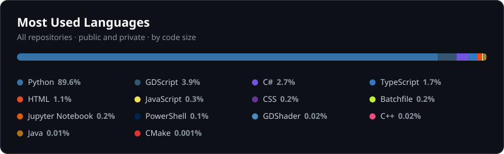

# github-lang-stats

Generates an SVG with the share of each programming language across **all**
of your GitHub repositories, public and private, similar to the
"Most Used Languages" card.



> The image above is the `language-stats.svg` generated by the workflow.
> Because it is stored in this repository and the README references it with a
> relative path (`./language-stats.svg`), the chart shows up for anyone who
> opens this page on GitHub. There is no need to copy it to another repository
> or README. On the first workflow run the file does not exist yet, so the
> image only appears after the first run (manual or scheduled).

## Setup

1. **Create the repository** on GitHub, for example `github-lang-stats`
   (private or public, both work), and push these files to it.

2. **Create a Personal Access Token (PAT)**:
   - Go to GitHub → Settings → Developer settings → Personal access tokens
     → Fine-grained tokens (or classic).
   - Grant the `repo` scope (to see private repositories) and `read:user`.
   - Copy the generated token.

3. **Add the token as a secret** in the repository that holds this project:
   - Settings → Secrets and variables → Actions → New repository secret
   - Name: `GH_PAT`
   - Value: the token from step 2.

   > The automatic Actions `GITHUB_TOKEN` **does not work** here: it can only
   > see the repository the Action runs in, so a personal token is required.

4. **Done.** The workflow in `.github/workflows/update-language-stats.yml`
   runs every day at 08:00 and 15:00 Brasília time (11:00 and 18:00 UTC), and
   whenever you trigger it manually in Actions → Run workflow. GitHub may delay
   scheduled runs during busy periods. It generates/updates
   `language-stats.svg` and commits it automatically.

5. **Show the SVG** wherever you like, for example in your profile README:

   ```markdown
   
   ```

## Run locally

```bash
pip install -r requirements.txt
export GH_TOKEN=ghp_xxx
python language_stats.py
```

This writes `language-stats.svg` to the current folder and prints the share of
each language in the terminal.

## How the calculation works

For each of your repositories (public **and private**, including archived
ones), the script reads the file tree of the default branch and sums the size
in bytes of the code files, classified by extension. New repositories are
picked up automatically on the next run.

Contributions count too, but only your part:

- **Forks**: only the files you changed compared with the original project.
- **Other people's or organizations' repositories** (where you are a
  collaborator or member, or sent commits/PRs): only the files your commits
  touched.

The extension and color table comes from
[GitHub Linguist](https://github.com/github-linguist/linguist) (the same one
GitHub uses) and is downloaded on every run, so any language GitHub recognizes
(GDScript, GDShader, ...) is counted without code changes. Ambiguous extensions
(`.gd` can be GDScript or GAP) are resolved with the languages GitHub itself
detected in that repository.

Generated or dependency folders (`build/`, `dist/`, `node_modules/`, `venv/`,
...) are ignored, so accidentally committed artifacts (for example a
PyInstaller `build/`, which GitHub reports as "TeX") do not skew the result.
Data and prose (JSON, YAML, SQL, Markdown) are not counted either, as on
GitHub. Every language found appears in the chart, with no "Other" bucket, even
with very small shares (`0.03%`).

## Customization

- **Change what counts in forks/contributions**: adjust `aggregate_languages()`
  in `language_stats.py`.
- **Analyze an organization**: set `GH_USER=org-name` (the token needs access
  to it).
- **Ignore more folders**: add names to `IGNORED_DIRS`.
- **Prefer a language for an ambiguous extension**: add the extension to
  `EXTENSIONS` (new languages already come from Linguist automatically).

## License

[MIT](./LICENSE)
